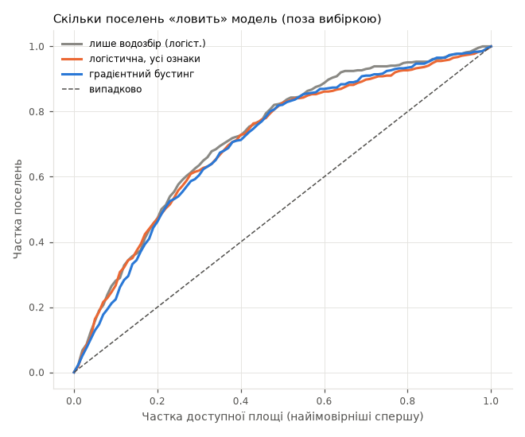
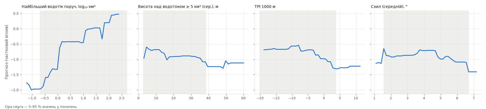
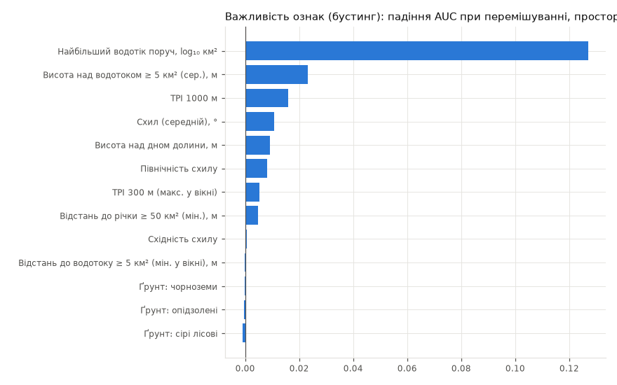
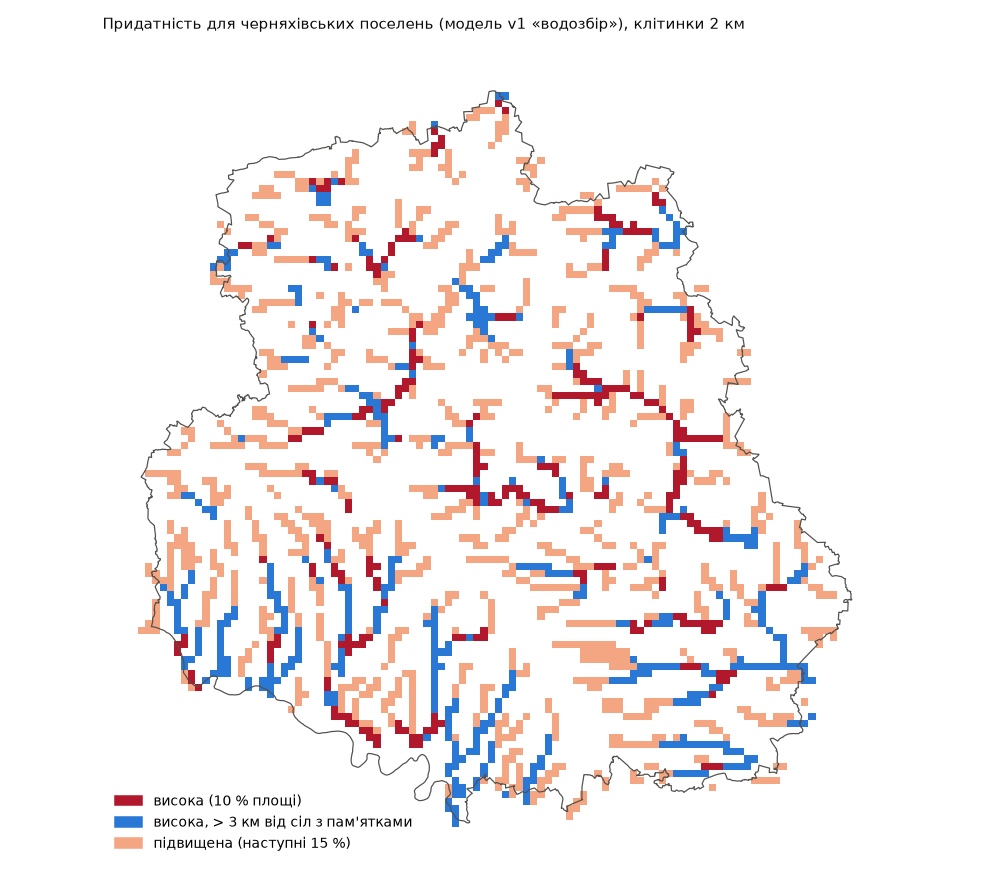
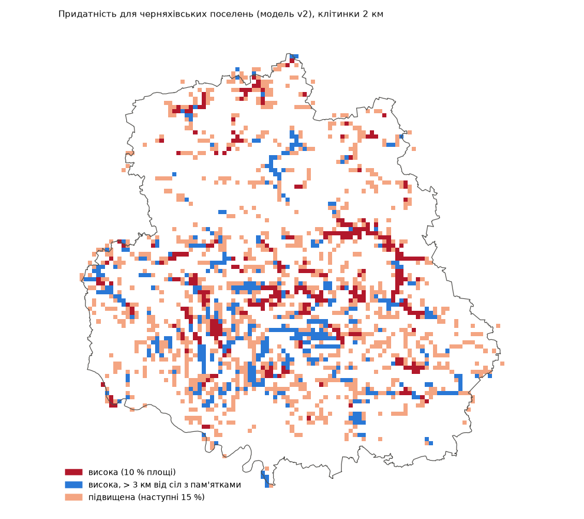
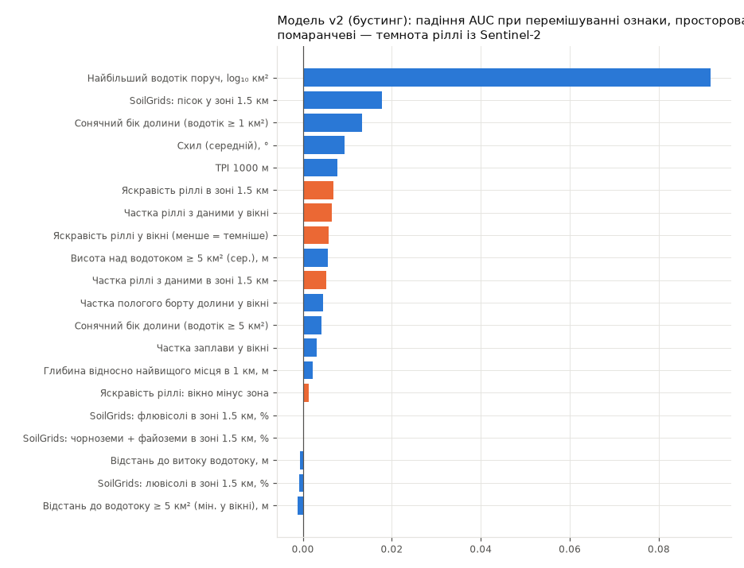

# Етап 5.2–5.3. Прогнозна модель: поселення проти фону (2026-10-08)

Мета: оцінити, наскільки можна передбачити місця черняхівських поселень з рельєфу
й води, і зробити основу для карти «де ще шукати» (крок 5.4). Попередні кроки:
`analysis.md` (етап 4), `refine.md` (крок 5.1 — прив'язка до берега).

> Оновлення 2026-11-16: таблиці нижче містять числа після етапу B
> (`results/model_stats.json`); з 2026-11-16 опубліковано дві карти з перемикачем —
> **v1** («лише водозбір») і **v2** — див. розділ «Етап D. Модель v2» наприкінці.

**Підсумок.** Модель працює, але фактично зводиться до одного правила: **поселення
стоять біля більших водотоків**. Рельєф, експозиція й ґрунти поза вибіркою нічого
не додають. Чесна оцінка на рівні сіл — AUC ≈ 0.61: помітно краще за випадковість,
але це звуження районів пошуку, а не вказівка на конкретні ділянки.

## Відтворення

```
.venv/Scripts/python -m pip install scikit-learn      # один раз
.venv/Scripts/python -X utf8 research/chernyakhiv/05c_model.py   # ~1 хв
```

Скрипт: `05c_model.py`. Числа — `results/model_stats.json`; графіки —
`results/model_capture.png`, `model_importance.png`, `model_partial.png`.
Карта (растр і публічний шар) — окремим скриптом `05d_map.py`, див. «Крок 5.4».
Тести: `tests/test_chernyakhiv_model.py`.

## Дані

- **Присутність:** 491 поселення в уточнених положеннях (`sites_refined`, крок 5.1).
- **Фон:** 5000 випадкових точок області, відібраних так, щоб їхня відстань до
  сучасної забудови мала той самий розподіл, що й у пам'яток (половина пам'яток
  стоїть у межах або на краю села — так їх знаходили й так їх геокодовано). Модель
  порівнює місця поселень з тим, що було **доступне біля сіл**; сама відстань до
  забудови не є ознакою. Фон НЕ прив'язується до води (на відміну від контролю в
  кроці 5.1): він має показувати доступні місця, а не береги.

## Ознаки

Усі — растри 30 м, взяті **у вікні ±240 м**, а не в точці:

| Ознака | Як |
|---|---|
| Найбільший водотік поруч | log₁₀ макс. водозбору у вікні |
| Відстань до водотоку ≥ 5 км² | мін. у вікні (обмеж. 3 км) |
| Висота над водотоком ≥ 5 км² | середня у вікні |
| Відстань до річки ≥ 50 км² | мін. у вікні (обмеж. 10 км) |
| TPI 300 м | макс. у вікні (бровка поруч) |
| TPI 1000 м, висота над дном долини | середні |
| Схил, північність, східність | середні |
| Ґрунти HWSD | клас у точці (one-hot) |

Абсолютна висота не використовується: вона здебільшого кодує регіон (великі
долини, маршрути дослідників), а не вибір місця.

**Чому вікно, а не точка — знайдений артефакт.** Перша версія брала значення в
точці. Бустинг дав AUC 0.79 і «ловив» 57 % поселень у 10 % площі, а головною
ознакою стала точна відстань до водотоку. Причина: крок 5.1 ставить прив'язані
пам'ятки рівно за 150 м від русла — 53 % пам'яток мали відстань 120–180 м проти 4 %
випадкових точок. Модель вивчала відступ, а не ландшафт. Віконні ознаки цей слід
прибирають; справжнє положення пам'ятки й так відоме з точністю до сотень метрів.

## Моделі й перевірка

- **Лише водозбір** — логістична регресія на двох ознаках (найбільший водотік
  поруч, відстань до водотоку ≥ 5 км²). База.
- **Логістична, усі ознаки** (+ квадрати, регуляризація C = 0.3).
- **Градієнтний бустинг** (глибина 3, 300 ітерацій, мін. 40 у листі).
- **Просторова крос-валідація:** блоки 25 × 25 км випадково розподілені на 5 фолдів,
  3 повтори (15 фолдів). Модель перевіряється на блоках, яких не бачила.

## Результати (поза вибіркою)

| Метрика | Лише водозбір | Логістична | Бустинг |
|---|---|---|---|
| AUC, поселення vs фон (сер. по фолдах ± sd) | **0.73** ± 0.04 | 0.72 ± 0.04 | 0.71 ± 0.04 |
| Індекс Бойса | 0.95 | 0.91 | 0.97 |
| Поселень у 10 % найпридатнішої площі | 28 % | 27 % | 23 % |
| Поселень у 20 % найпридатнішої площі | **47 %** | 48 % | 46 % |
| AUC на рівні сіл (карта з КВ, p90 у 2 км) | 0.61 | 0.60 | 0.62 |

Для порівняння на рівні сіл: найбільший водотік у 2 км **без жодної моделі** —
AUC 0.61.



Як читати:
- **AUC 0.73** — частково завищено: присутності прив'язані до води з тексту
  каталогу, а сходинки на кривій водозбору рівно на 1 і 10 км² — це пороги
  прив'язки з кроку 5.1 (див. графік нижче). Сам зв'язок справжній, але його сила
  в цій метриці перебільшена.
- **Перевірка на рівні сіл — головна чесна оцінка.** Вона не залежить ні від
  прив'язки, ні від похибки геокодування: координати сіл точні, а пам'ятка або є
  біля села, або ні. Тут модель = «найбільший водотік поруч», AUC ≈ 0.61. Медіанний
  найбільший водозбір у радіусі 1 км: 53 км² біля сіл з пам'ятками проти 18 км² біля
  інших.
- **Складніші моделі нічого не додають**: логістична з усіма ознаками й бустинг
  не кращі за двохознакову базу, а бустинг навіть трохи гірший (перенавчається на
  шумі).
- **Індекс Бойса 0.91–0.97** — прогноз монотонний: що вища оцінка, то частіше там
  поселення. Тобто як ранжування карта коректна.
- 20 % доступної площі містять ~47 % поселень — приблизно в 2.4 раза щільніше за
  середнє.





Важливість (бустинг, падіння AUC при перемішуванні): найбільший водотік поруч
0.13; усе інше ≤ 0.02 (висота над водотоком і TPI 1000 м ~0.02, схил, висота над
дном долини, північність ~0.01); ґрунти — 0. Логістична регресія показує ті самі слабкі
тенденції: нижче над водотоком, але вище над дном долини, трохи частіше на
не-північних схилах.

## Додаткові перевірки на артефакти

| Тест | Лише водозбір | Логістична | Бустинг |
|---|---|---|---|
| AUC: модель з уточнених точок, пам'ятки в положеннях етапу 2 | 0.53 | 0.52 | 0.53 |
| AUC: лише 115 неприв'язаних пам'яток | 0.50 | 0.46 | 0.48 |

- Положення етапу 2 зсунуті на 300–1000 м, а сигнал локальний (±240 м), тож шум
  його майже затирає. Цей тест показує, що ознаки дуже чутливі до точності
  положення, але не розрізняє, артефакт це чи ні.
- 115 неприв'язаних пам'яток — ті, в описі яких **немає води**. Модель їх не
  розпізнає (≈ 0.5). Це не обов'язково вада: це інша група (плато без згадки води),
  і водна модель її в принципі не покриває. Для карти пошуку це означає: приблизно
  кожне четверте поселення стоїть так, що «водне» правило його не знайде.

## Висновки для карти (крок 5.4)

1. Основа карти — **розмір найближчого водотоку**. Складна модель не виправдана:
   краще проста, прозора оцінка (логістична «лише водозбір»), яку легко пояснити в
   легенді.
2. Масштаб — 1–2 км (рішення 1) — якраз той, на якому оцінка перевірена (рівень
   сіл).
3. Очікувана якість — помірна (AUC ~0.6 на рівні сіл): карта звужує райони
   пошуку, а не вказує ділянки. Це треба написати в застереженні.
4. «Кандидати для обстежень»: зони високої оцінки без відомих пам'яток поруч. Але
   відсутність пам'яток може означати й те, що там ніхто не шукав (упередженість
   обстежень), — треба врахувати маршрути (Хавлюк — 263 з 513 пунктів).

---

# Крок 5.4. Карта придатності

Скрипт: `05d_map.py` (~5 хв). З 2026-11-16 будує **дві карти**, і обидві
опубліковано з перемикачем (рішення користувача: v2 пройшла критерій, але приріст
у межах шуму, а карта інша): **v1** — логістична «лише водозбір» (типова на
сайті), **v2** — логістична v2 (розділ «Етап D» нижче). Обидві навчені на всіх
поселеннях. Придатність — перцентиль серед фонових (доступних) точок, 0–100.
У тексті нижче числа v2, у дужках — v1.

| Вихід | Де | Доступ |
|---|---|---|
| Растр придатності 150 м | `data/processed/chernyakhiv_model/suitability_150m_v1.tif`, `_v2.tif` | лише локально |
| Клітинки 2 × 2 км, класи | `docs/data/chernyakhiv_potential.geojson` (v1, 111 КБ), `chernyakhiv_potential_v2.geojson` (135 КБ) | публічний (рішення 1) |
| Прев'ю й числа | `results/potential_map.png` (v1), `potential_map_v2.png`, `results/map_stats.json` | у репозиторії |

Клітинка оцінюється 90-м перцентилем придатності всередині (як у перевірці на рівні
сіл). Класи — за часткою клітинок області: **висока** — 10 % (738 клітинок),
**підвищена** — наступні 15 % (1106). **Кандидат** — висока клітинка, центр якої
далі 3 км від усіх сіл з відомими пам'ятками (416 з 738; у моделі «лише
водозбір» — 453 з 739).





Карта v1 повторює мережу середніх і великих водотоків. v2 теж тримається її, але зсуває вагу:
більше високих клітинок на півдні центру області, менше — вздовж Південного Бугу
(ґрунтові ознаки зони 1.5 км). Прямі «смуги» — не артефакт: там річки течуть майже
точно зі сходу на захід і з півночі на південь; «драбинку» дає сітка 2 км.

**Перевірка на селах** (клас клітинки, в якій стоїть село):

| | висока | підвищена | поза класами |
|---|---|---|---|
| Частка площі | 10 % | 15 % | 75 % |
| Села з пам'ятками (299) | **30 %** (27 %) | 25 % (29 %) | 44 % (44 %) |
| Інші села (1202) | 14 % (18 %) | 18 % (22 %) | 68 % (60 %) |

У класі «висока» сіл з пам'ятками втричі більше, ніж за часткою площі, і в
2.1 раза більше, ніж інших сіл (у моделі «лише водозбір» — у 1.5 раза).
**Увага:** ця таблиця — на карті, навченій на ВСІХ поселеннях, тобто оцінка
оптимістична, і модель із 20 ознаками підлаштовується сильніше за двохознакову.
Чесне порівняння — КВ на рівні сіл: 0.632 проти 0.610 (розділ «Етап D»).

Обмеження (для застереження на сайті):
- Оцінка — здебільшого «біля якого водотоку» з поправками на бік долини, рельєф і
  ґрунти; історичні чинники не враховано. Помірна якість: AUC ≈ 0.63 на рівні сіл.
- ~23 % відомих поселень (без води в описі) модель розпізнає ледь краще за
  випадковість (AUC 0.54).
- «Кандидати» — це місця, де пам'яток не відомо, але причина може бути й у тому,
  що там ніхто не шукав. 56 % високих клітинок — кандидати, тобто фільтр поки
  слабо вибірковий; маршрутів обстежень у даних немає.
- Карта показує придатність ландшафту, а не наявність пам'яток.

---

# Етап D. Модель v2: ознаки з літератури + темнота ріллі (2026-11-16)

Скрипт: `05g_model_v2.py` (~8 хв; ~4 ГБ пам'яті). Числа —
`results/model_v2_stats.json`, графік — `results/model_v2_importance.png`.
Тести: `tests/test_chernyakhiv_model_v2.py`. Ті самі 491 поселення, ті самі 5000
фонових точок і та сама просторова КВ (блоки 25 км, 5 фолдів × 5 повторів), що й
вище, — змінено лише набір ознак.

**Підсумок.** Модель v2 **формально проходить критерій** з PLAN.md (рівень сіл
> 0.61 і поселення без води в описі > 0.5) і тому прийнята: рівень сіл
0.610 → **0.632**, поселення без води 0.50 → **0.54**. Але приріст малий: 95 %
довірчий інтервал приросту на рівні сіл — [−0.008; +0.054], тобто нуль не
виключено (кращою v2 виходить у 93 % бутстреп-вибірок). Це «трохи краще, ніж
лише водозбір», а не нова якість. Справжня перевірка — незалежні дані етапу E.

## Нові ознаки

| Група | Ознака | Як порахована |
|---|---|---|
| Сонячний бік | `sun_ch1`, `sun_ch5` | Південна складова напряму від комірки до найближчого русла (≥ 1 і ≥ 5 км²): +1 — комірка рівно на північ від русла, борт обернений на південь; −1 — на північ. У точці, не у вікні: бік русла — саме те, що дає текст каталогу |
| Тераса | `terrace_share` | Частка вікна ±240 м, що є пологим бортом: схил 1–6°, 50–400 м від русла ≥ 1 км², 3–20 м над ним |
| Заплава | `floodplain_share` | Частка вікна, що пласка (< 1.5°) і нижча 2.5 м над руслом |
| Витоки | `dist_head` | Відстань до початку русла (де водозбір уперше сягає 1 км²), мін. у вікні |
| Схованість | `depth1000` (+ TPI 1000 м) | Наскільки місце нижче за найвищу точку в радіусі 1 км |
| Ґрунти | `sg_*_zone` | SoilGrids у зоні 1.5 км: чорноземи + файоземи, лювісолі, флювісолі, пісок |
| Темнота ріллі | `dark_point`, `dark_zone`, `dark_rel` | Відносна яскравість голої ріллі із Sentinel-2 (`bare_soil.md`; менше = темніше): вікно, зона 1.5 км, вікно мінус зона. Під лісом і в селах вимірювань немає — вікно заповнюється значенням зони, зона — медіаною області |
| | `cover_point`, `cover_zone` | Частка комірок, де вимірювання є (тобто ріллі) |

Оптимум розміру водотоку (ознака 4 з `literature.md`) — квадрати ознак у
логістичній регресії. Не зроблено: джерела з OSM (локальних даних немає, Overpass
недоступний), сучасний ліс окремою ознакою (частково його замінює `cover_*`),
сусідство (за планом — лише для ранжування кандидатів, не для навчання).

## Що дала кожна група (поселення vs фон, поза вибіркою)

Логістична регресія з квадратами, якщо не сказано інше. «Приріст» — парна
різниця з базою на тих самих 25 фолдах; розкид самої бази між фолдами — 0.03.

| Набір ознак | AUC | Приріст до «лише водозбір» (± sd) | Фолдів краще | AUC, без води в описі | AUC, положення етапу 2 |
|---|---|---|---|---|---|
| Лише водозбір (база) | 0.728 | — | — | 0.496 | 0.534 |
| + оптимум (квадрати) | 0.727 | −0.001 ± 0.003 | 10/25 | 0.495 | 0.531 |
| + сонячний бік | 0.723 | −0.004 ± 0.011 | 13/25 | 0.505 | 0.530 |
| + тераса й заплава | 0.734 | +0.006 ± 0.016 | 18/25 | 0.483 | 0.533 |
| + витоки | 0.724 | −0.003 ± 0.004 | 6/25 | 0.495 | 0.530 |
| + схованість | 0.720 | −0.007 ± 0.011 | 5/25 | 0.482 | 0.527 |
| + ґрунти SoilGrids | 0.735 | +0.008 ± 0.018 | 18/25 | 0.531 | 0.564 |
| + темнота ріллі | 0.734 | +0.006 ± 0.015 | 17/25 | 0.532 | 0.559 |
| **v2 без темноти** (15 ознак) | 0.734 | +0.006 ± 0.026 | 17/25 | 0.532 | 0.561 |
| **v2 з темнотою** (20 ознак) | **0.735** | +0.007 ± 0.027 | 16/25 | **0.539** | 0.570 |
| Бустинг, ознаки v1 | 0.715 | −0.013 ± 0.026 | 8/25 | 0.469 | 0.538 |
| Бустинг, v2 без темноти | 0.739 | +0.011 ± 0.027 | 17/25 | 0.524 | 0.564 |
| Бустинг, v2 з темнотою | 0.741 | +0.013 ± 0.027 | 18/25 | 0.542 | 0.579 |

Жодна група не дає приросту, більшого за розкид між фолдами. Помітне одне:
ґрунти (SoilGrids і темнота ріллі) зсувають з мертвої точки поселення **без води
в описі** (115, ~23 %): 0.50 → 0.53–0.54. Для них водна модель була сліпа.

## Перевірка на рівні сіл (головна)

Карта з КВ (кожен блок 25 км прогнозує модель, що не бачила його поселень), p90
придатності у 2 км довкола села; 298 сіл з пам'ятками проти 1202 інших. Середнє
за 5 розбиттями на фолди; бутстреп по селах (2000 вибірок) для приросту.

| Модель | AUC | sd між розбиттями | Приріст, 95 % ДІ | Вибірок, де краще за базу |
|---|---|---|---|---|
| Лише водозбір (база) | 0.610 | — | — | — |
| Водозбір + сонячний бік | 0.620 | 0.002 | +0.010 [+0.002; +0.019] | 99 % |
| v2 без темноти | 0.620 | 0.009 | +0.012 [−0.019; +0.041] | 78 % |
| v2 без темноти + яскравість ріллі | 0.633 | 0.009 | +0.025 [−0.007; +0.055] | 94 % |
| v2 без темноти + частка ріллі | 0.619 | 0.007 | +0.011 [−0.020; +0.041] | 76 % |
| **v2 з темнотою** (карта) | **0.632** | 0.008 | +0.024 [−0.008; +0.054] | 93 % |
| Бустинг, v2 без темноти | 0.631 | 0.007 | +0.025 [−0.011; +0.062] | 91 % |
| Бустинг, v2 з темнотою | 0.639 | 0.009 | +0.033 [−0.003; +0.068] | 96 % |

## Що саме додала темнота ріллі

Окремий рядок, як і домовлено: v2 без темноти → v2 з темнотою.

| | без темноти | з темнотою | різниця |
|---|---|---|---|
| AUC, поселення vs фон | 0.734 | 0.735 | +0.001 |
| AUC, поселення без води в описі | 0.532 | 0.539 | +0.007 |
| AUC на рівні сіл (логістична) | 0.620 | 0.632 | +0.012 |
| AUC на рівні сіл (бустинг) | 0.631 | 0.639 | +0.008 |

- На рівні окремих поселень — нічого (як і в пілоті S: 0.712 → 0.712).
- На рівні сіл — невеликий плюс в обох моделях (+0.008…+0.012) за розкиду між
  розбиттями 0.007–0.009: напрям сталий, але це на межі шуму.
- Плюс дає **сама яскравість**, а не частка ріллі (0.633 проти 0.619). Це добре:
  частка ріллі могла б кодувати не вибір місця, а те, де пам'ятки знаходять
  (підйомний матеріал збирають на оранці).
- Одновимірно сигнал слабкий і не той, що в літературі: поселення без води в
  описі лежать на трохи **світлішій** ріллі, ніж фон (AUC 0.55, p = 0.07), а
  прив'язані до берега — на трохи темнішій (0.46, p = 0.01; борти долин і так
  темніші за плато). Тяжіння до темних ґрунтів як такого не видно.

## Окремі ознаки: що видно і чого не видно

Одновимірно (AUC поселення vs фон; p — Манна–Вітні), `results/model_v2_stats.json`:

| Ознака | Усі | Прив'язані (376) | Без води в описі (115) |
|---|---|---|---|
| Сонячний бік (русло ≥ 1 км²) | 0.53 (p = 0.014) | 0.53 (0.09) | 0.56 (0.04) |
| Частка пологого борту | 0.64 | 0.69 | 0.48 |
| Частка заплави | 0.66 | 0.72 | 0.45 |
| Глибина відносно околиць 1 км | 0.60 | 0.61 | 0.58 (0.004) |
| Відстань до витоку | 0.50 | 0.48 | 0.56 (0.02) |
| Пісок у зоні 1.5 км | 0.54 (0.001) | 0.54 | 0.57 (0.01) |
| Лювісолі в зоні 1.5 км | 0.45 (0.0005) | 0.44 | 0.49 |
| Чорноземи + файоземи в зоні | 0.54 (0.002) | 0.55 | 0.53 |

- **Сонячний бік** підтверджується, але слабко: 0.53 на рівні точки проти 59 %
  у перевірці за текстом (`literature.md`). До AUC «поселення vs фон» не додає;
  на рівні сіл — єдина ознака з приростом, значущим окремо (+0.010), хоча й
  крихітним. У бустингу — третя за важливістю.
- **Тераса й заплава** — здебільшого слід прив'язки: прив'язані точки стоять за
  150 м від русла, тому у вікні в них більше і бортів, і заплави, ніж у фону
  (0.69 / 0.72), а в неприв'язаних — ні (0.48 / 0.45). «Уникання заплав» цими
  даними перевірити не можна; у текстах каталогу заплава — 10 % поселень.
- **Схованість** — єдина рельєфна ознака, що працює і для поселень без води
  (0.58): вони теж у знижених місцях. До моделі з водозбором не додає.
- **Ґрунти** — уникання лювісолів, легке тяжіння до темних ґрунтів і (несподівано)
  до піщаніших; усе слабке, як у `soils.md`.

Важливість у бустингу v2 (падіння AUC при перемішуванні): найбільший водотік
поруч 0.092; пісок у зоні 0.018; сонячний бік 0.013; схил 0.009; TPI 1000 м
0.008; темнота (зона, вікно, покриття) по 0.005–0.007; решта ≤ 0.005.



## Рішення і застереження

1. **v2 прийнято за критерієм** (0.632 > 0.61 і 0.539 > 0.5), але v1 не знято:
   рішення користувача — **публікувати обидві карти з перемикачем** (на сайті й у
   закритому перегляді; типова — v1), доки етап E не покаже, котра краща. Для
   карти v2 взято логістичну v2 з темнотою (`MAP_MODEL = "v2"`): бустинг на 0.007 кращий на
   рівні сіл, але це менше за розкид, а логістичну простіше пояснити.
2. **Приріст не доведено статистично** — нуль у довірчому інтервалі. Якби
   критерій вимагав значущості, лишилась би модель «лише водозбір».
3. **Карта змінилась значно більше, ніж метрики**: рангова кореляція растру
   150 м з попереднім — 0.73, найпридатніші 10 % площі збігаються лише на 56 %;
   на публічній сітці 2 км з 739 «високих» клітинок v1 у v2 лишаються 327 (44 %).
   Ґрунтові ознаки зони 1.5 км дають регіональні тренди (більше «високих»
   клітинок на півдні центру області, менше — вздовж Південного Бугу). Частина
   цього може бути відбитком того, де працювали дослідники; блоки КВ по 25 км
   захищають від цього лише частково.
4. Модель і далі здебільшого «більший водотік поруч» (важливість 0.09 проти
   ≤ 0.02 в усього іншого).
5. Перевірити по-справжньому можна лише незалежними точками (етап E).
